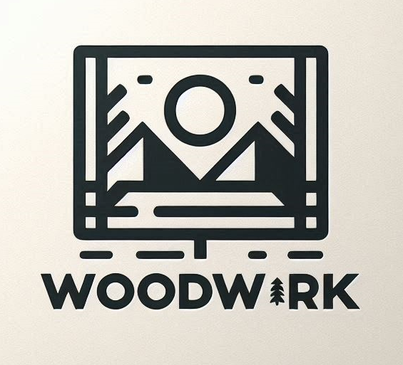

<div align="center">
  

# WoodWork

Plataforma para encontrar, reservar y gestionar espacios de coworking.

   


[🎬 Video demo](https://youtu.be/Ez0-VTziXIk) · [🎨 Diseño en Figma](https://www.figma.com/design/V6jOW9y46O1DyyN7e4nGNK/WoodWork?node-id=32-63&t=gq9Hx6rSl6M7aesD-1) · [📋 Estado](docs/STATUS.md) · [🗺️ Roadmap](docs/ROADMAP.md)
</div>

> Proyecto de equipo de la simulación laboral de [No Country](https://www.nocountry.tech) (cohorte s15-17, 2024), retomado para terminarlo y modernizarlo. El nombre del repo dice "angular" pero el front es **React**.

## Qué resuelve

Conecta a trabajadores independientes, emprendedores y pequeñas empresas con espacios de coworking: buscarlos, ver sus servicios y reservarlos por hora.

| Feature | Estado |
|---|---|
| Registro y login con JWT, contraseñas con BCrypt | ✅ (con fallas de autorización: ver [auditoría](docs/audits/2026-10-10-initial.md#6-seguridad)) |
| Listado y detalle de espacios con servicios ("qualities") | ✅ |
| Diseño responsive (mobile y desktop) | ✅ |
| Reserva por horas con validación de capacidad y horario | 🚧 el back la valida; el front todavía no la envía |
| Perfil con historial de reservas | 🚧 |
| Búsqueda y filtrado por ubicación y precio | 🚧 |
| Valoraciones, recordatorios, gestión de espacios, contacto | 📝 planificado ([roadmap](docs/ROADMAP.md)) |

## Stack

| Parte | Tecnologías |
|---|---|
| Back (`backend/coworkProject/`) | Java 17 (compila con JDK 21), Spring Boot 3.2.5 (Web, Data JPA, Security, Validation), JWT (jjwt 0.11.5), MapStruct, Lombok, springdoc-openapi, Cloudinary, PostgreSQL |
| Front (`frontend/`) | React 18, TypeScript 5.4, Vite 5, React Router 6, NextUI, Tailwind 3, React Hook Form, axios |
| Infra | Docker Compose (Postgres 18), deploy original en Render (back) y Netlify/Vercel (front) |

Arquitectura, modelo de datos y endpoints: [docs/ARCHITECTURE.md](docs/ARCHITECTURE.md).

## Levantar el proyecto en local

### Prerrequisitos

| Herramienta | Versión | Cómo comprobarla | Cómo instalarla |
|---|---|---|---|
| Git | cualquiera | `git --version` | [git-scm.com](https://git-scm.com) |
| Docker + Compose v2 | Docker 24+ | `docker compose version` | [Docker Desktop](https://docs.docker.com/get-docker/) |
| JDK (solo opción B) | 21 (Temurin) | `java -version` | [SDKMAN](https://sdkman.io): `sdk env install` en la raíz (lee `.sdkmanrc`) ⚠️ no verificado en la sesión |
| Node.js (solo opción B) | 24 LTS | `node -v` | [nvm](https://github.com/nvm-sh/nvm): `nvm install` en la raíz (lee `.nvmrc`) ⚠️ no verificado en la sesión |

Maven no hace falta: se usa el wrapper (`./mvnw`).

### Configurar variables de entorno

Cada parte tiene un archivo de ejemplo commiteado. **Los valores sirven tal cual para local**: copialos sin editar. El archivo real está en `.gitignore`.

| Archivo de ejemplo | Copiar a | Quién lo lee | Qué contiene |
|---|---|---|---|
| `backend/coworkProject/src/main/resources/env.properties.example` | `backend/coworkProject/src/main/resources/env.properties` | Spring (`spring.config.import`, desde el **classpath**) | DB, Cloudinary, secreto JWT |
| `frontend/.env.example` | `frontend/.env` | Vite (`VITE_*`) | URL de la API (⚠️ hoy ignorada: ver T-006) |

Desde la raíz del repo:

```bash
cp backend/coworkProject/src/main/resources/env.properties.example backend/coworkProject/src/main/resources/env.properties
```

```bash
cp frontend/.env.example frontend/.env
```

En producción se definen como variables de entorno del proveedor: `DB_URL`, `DB_NAME`, `DB_USER`, `DB_PASSWORD`, `DB_DRIVER_CLASS_NAME`, `DB_DIALECT`, `CLOUDINARY_NAME`, `CLOUDINARY_API_KEY`, `CLOUDINARY_API_SECRET`, `JWT_SECRET` (desde T-001) y, en el build del front, `VITE_API_URL` (desde T-006). Detalle de cada una: [docs/SETUP.md](docs/SETUP.md#variables).

### Opción A · Todo en contenedores (la más simple)

Solo necesitás Git y Docker. Desde la raíz del repo (con los `.example` ya copiados; si no, se usan los valores del ejemplo igual):

```bash
docker compose --profile app up -d --build --wait
```

Resultado esperado: `Container woodwork-db-1 Healthy`, `Container woodwork-server-1 Healthy`, `Container woodwork-client-1 ...`. La primera vez tarda unos minutos (descarga dependencias).

| Qué | URL |
|---|---|
| Front | http://localhost:5173 |
| API | http://localhost:8080/v1/api (health: `/v1/api/render/health`) |
| Swagger | http://localhost:8080/swagger-ui |

Crear el usuario demo (no hay datos seed todavía, T-016):

```bash
curl -s -X POST http://localhost:8080/v1/api/auth/register -H 'Content-Type: application/json' -d '{"email":"demo@woodwork.local","password":"Demo1234!","fullName":"Demo User"}'
```

Resultado esperado: un JSON con `"token":"eyJ..."` (si ya existe, HTTP 403 sin cuerpo).

> ⚠️ Hoy falla: el front llama a la API de **producción**, no al back local, así que el login desde la UI no usa este usuario. Ver T-006.

Apagar y borrar los datos:

```bash
docker compose --profile app down -v
```

### Opción B · Desarrollo (DB en contenedor, back y front locales)

**Inicio rápido:** `./scripts/dev.sh` hace todos los pasos de abajo, espera los health checks, crea el usuario demo y muestra las URLs. `Ctrl+C` corta back y front; `./scripts/dev.sh --down` apaga la DB.

**Paso a paso** (lo mismo, a mano):

1. **Clonar.**
   ```bash
   git clone https://github.com/MatiasNicolasAcevedo/s15-17-t-java-angular.git
   ```
   ```bash
   cd s15-17-t-java-angular
   ```
   Resultado esperado: `ls` muestra `backend/ frontend/ docs/ scripts/ docker-compose.yml`.

2. **Fijar versiones de Java y Node** (raíz). ⚠️ no verificado en la sesión (SDKMAN/nvm no instalados en el entorno).
   ```bash
   sdk env install
   ```
   ```bash
   nvm install
   ```
   Resultado esperado: `java -version` → 21, `node -v` → v24.

3. **Copiar la configuración** (raíz): los dos `cp` de [Configurar variables de entorno](#configurar-variables-de-entorno).
   Resultado esperado: `ls backend/coworkProject/src/main/resources/` muestra `env.properties`.

4. **Levantar la DB** (raíz).
   ```bash
   docker compose up -d --wait
   ```
   Resultado esperado: `Container woodwork-db-1 Healthy`.

5. **Levantar el back** (desde `backend/coworkProject/`, en una terminal aparte).
   ```bash
   ./mvnw spring-boot:run
   ```
   Resultado esperado: `Started CoworkProjectApplication in ... seconds`. Chequeo:
   ```bash
   curl http://localhost:8080/v1/api/render/health
   ```
   → `Server is awake and running!`

6. **Crear el usuario demo**: el `curl` de register de la opción A. Resultado esperado: JSON con `token`.

7. **Levantar el front** (desde `frontend/`, en otra terminal).
   ```bash
   npm ci
   ```
   ```bash
   npm run dev
   ```
   Resultado esperado: `Local: http://localhost:5173/`. Abrí esa URL: se ve la home de WoodWork.
   > ⚠️ Hoy falla: el front llama a `https://woodwork.onrender.com` (producción), no a `localhost:8080`. Ver T-006.

8. **Iniciar sesión** en http://localhost:5173/login con `demo@woodwork.local` / `Demo1234!` → redirige a `/dashboard`. ⚠️ Hoy falla: ver T-006.

9. **Verificar** (raíz):
   ```bash
   ./scripts/verify.sh
   ```
   Resultado esperado: una línea `verify: server: ... · client: ...`. ⚠️ Hoy falla el lint del front: ver T-005.

10. **Apagar y limpiar**: `Ctrl+C` en las terminales del back y del front, y desde la raíz:
    ```bash
    docker compose down -v
    ```
    Resultado esperado: `Volume woodwork_db-data Removed`.

### Windows

- Usá **Git Bash** o **WSL** para los `.sh`. En PowerShell/CMD: `mvnw.cmd spring-boot:run` en lugar de `./mvnw` y `copy` en lugar de `cp` (con `\` en las rutas).
- Antes de clonar: `git config --global core.autocrlf input` (los scripts necesitan finales de línea LF).
- Docker Desktop con el backend WSL 2.

### Problemas frecuentes

| Síntoma | Causa | Solución |
|---|---|---|
| `ClassNotFoundException: org.hibernate.dialect.` al arrancar el back | `env.properties` no está en el classpath (p. ej. en `backend/coworkProject/`) | Copialo a `src/main/resources/env.properties` |
| `Connection to localhost:5432 refused` | La DB no está levantada | `docker compose up -d --wait` |
| `failed to bind host port ... 5173` / `8080` / `5432: address already in use` | Otro proceso usa el puerto (un `npm run dev` o un Postgres local) | Cortalo, o cambiá el puerto ([SETUP](docs/SETUP.md#puertos)) |
| El login desde la UI falla o usa otros datos | El front apunta a producción | T-006 |
| `npm run lint` falla con 3 warnings | Exports no-componentes en `src/services/Api.tsx` | T-005 |
| `./mvnw: Permission denied` | Clon viejo sin bit de ejecución | `chmod +x backend/coworkProject/mvnw` |
| `Tests are skipped` en Maven | `skipTests=true` en `pom.xml` | T-002 |
| Login devuelve 403 en vez de 401 | Email inexistente → excepción → `/error` bloqueado | T-012 |

Verificado el 2026-10-10 en Linux con Java 21.0.12, Node 22.22.0 (local) y 24 (imagen), Docker 29.8.2 / Compose v5.6.0.

## Tests y calidad

`./scripts/verify.sh` es el gate único (build + lint + tests de ambas partes; `--server` / `--client` para una sola). Hoy el back tiene 1 test (deshabilitado por el pom) y el front ninguno: la estrategia y el plan están en [docs/TESTING.md](docs/TESTING.md).

## Cómo se trabaja

GitHub Flow + Conventional Commits + PR por tarea: [CONTRIBUTING.md](CONTRIBUTING.md). El repo está preparado para desarrollo asistido por agentes ([AGENTS.md](AGENTS.md)): 🤖 el agente gratuito de IntelliJ para tareas chicas y bien especificadas, 🧠 un modelo de frontera para lo complejo, 👤 el dueño decide y mergea.

## Estado y roadmap

[docs/STATUS.md](docs/STATUS.md) (dónde estamos y qué sigue) · [docs/BACKLOG.md](docs/BACKLOG.md) · [docs/ROADMAP.md](docs/ROADMAP.md)

## Capturas

<div align="center">
  
  
  
  
  
</div>

Swagger y diagrama originales: [Swagger](https://github.com/MatiasNicolasAcevedo/s15-17-t-java-angular/assets/109118183/38fcc09d-aecb-46db-bfae-4be6226f17ca) · [Diagrama](https://github.com/MatiasNicolasAcevedo/s15-17-t-java-angular/assets/109118183/0cc3030c-3547-4a19-8deb-eb8a6fb91dac)

## Equipo original

| Nombre | Rol | Link |
|---|---|---|
| Diego Gonzalez | Team Lead | [Portfolio](https://www.behance.net/ushiwushi) |
| Agustín Avellaneda | Project Manager / Frontend | [Portfolio](https://portfolio.agustin.top) |
| Andrea Laurino | QA manual | [Portfolio](https://andrea-laurino-portfolio-interactive.vercel.app/) |
| Clarisa Gorostidi | QA manual | [LinkedIn](https://www.linkedin.com/in/clarisag/) |
| Angélica Borrero | Diseño UX/UI | [LinkedIn](https://www.linkedin.com/in/ang%C3%A9lica-borrero-b14591186/) |
| Diego Raúl Barrionuevo | Frontend | [GitHub](https://github.com/kalchaqui) |
| Matías N. Acevedo | Frontend · mantenedor actual | [Portfolio](https://porfolio-matias-acevedo.web.app/) |
| Efrén Morales | Backend | [GitHub](https://github.com/fr3nm0) |
| Fabián Carabajal | Backend | [LinkedIn](https://www.linkedin.com/in/fabian1501/) |
| Franco Lacourt | Backend | [GitHub](https://github.com/FrancoLacourt) |
| Santiago Figliuolo | Backend | [GitHub](https://github.com/SantiagoFigli) |

## Licencia y autor

Licencia: pendiente de definir (ver Backlog). Mantenido por [Matías Nicolás Acevedo](https://github.com/MatiasNicolasAcevedo) sobre el trabajo del equipo original.
