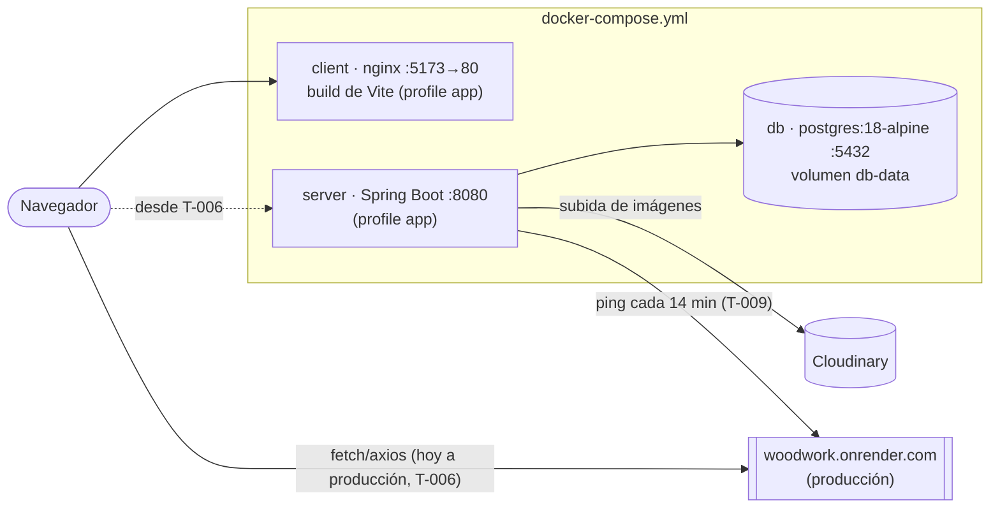
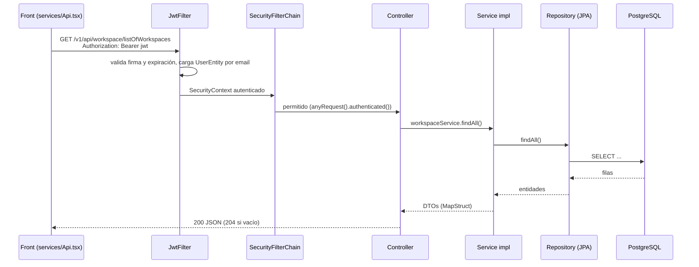
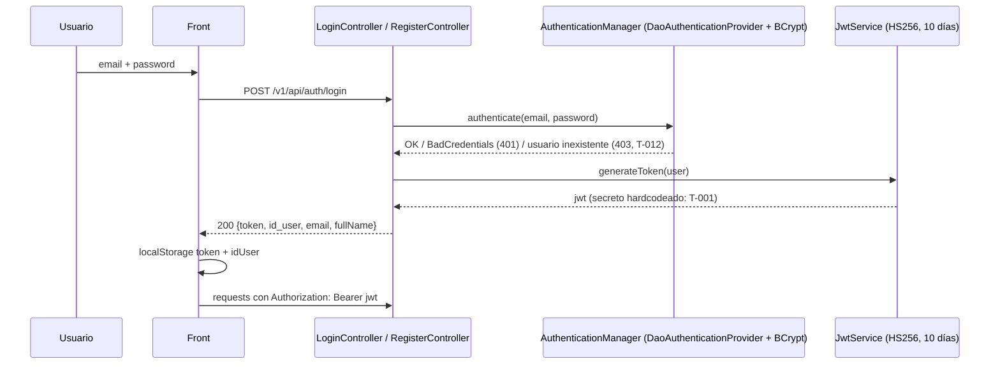
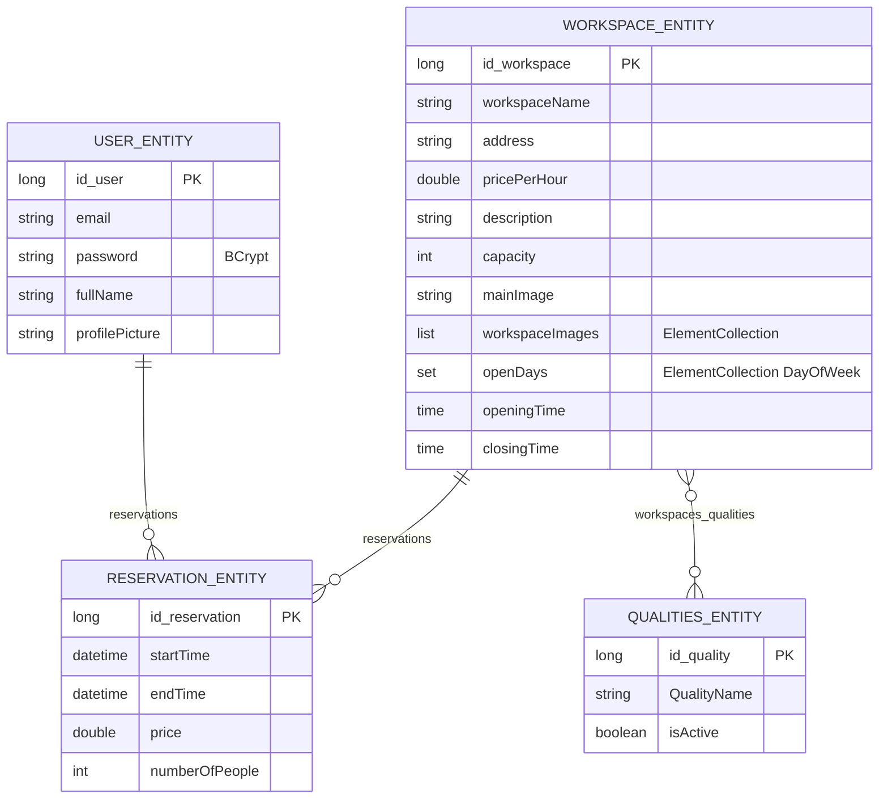

# Arquitectura

Estado al 2026-10-10 (auditoría inicial). Rutas de código relativas a `backend/coworkProject/src/main/java/org/example/coworkproject/` y `frontend/src/`.

## Componentes (local)

En desarrollo (`scripts/dev.sh`): solo `db` en contenedor; back con `./mvnw spring-boot:run` y front con `vite` (hot reload).

## Flujo de una request

Errores: no hay `@RestControllerAdvice`; las excepciones no capturadas van a `/error`, que Security bloquea → **403 sin cuerpo** (T-012).

## Autenticación

Sin roles ni chequeo de dueño: cualquier usuario autenticado accede a todo (T-003).

## Modelo de datos

Esquema generado por Hibernate (`ddl-auto=update`), sin migraciones. Ojo: `QualitiesEntity.workspaces` tiene `cascade = ALL` (borrar una quality puede borrar workspaces).

## Endpoints principales

Prefijo `/v1/api`. Públicos: `/auth/*`, `/render/health`, Swagger. Contrato completo: `http://localhost:8080/v3/api-docs`.

| Endpoint | Pantalla que lo usa |
|---|---|
| `POST /auth/register` | `/register` (`views/RegisterView`) |
| `POST /auth/login` | `/login` (`views/LoginView`) |
| `GET /user/getUserById/{id}` | todas (carga de usuario en `AuthProvider`) |
| `PUT /user/updateUser/{id}` (multipart) | `/editProfile/:id` — ⚠️ el front manda JSON |
| `PUT /user/changeUserPassword/{id}`, `DELETE /user/deleteUser/{id}`, `GET /user/listOfUsers` | ninguna |
| `GET /workspace/listOfWorkspaces` | `/dashboard`, `/editProfile/:id` |
| `GET /workspace/getWorkspaceById/{id}` | `/reservation/:id` |
| `POST /workspace/createWorkspace`, `PUT /updateWorkspace/{id}`, `DELETE /deleteWorkspace/{id}`, imágenes y qualities | ninguna (solo Swagger/Postman) |
| `POST /reservation/createReservation/{ws}/{user}` | ninguna — el modal de pago no lo llama |
| `GET /reservation/getReservationsByUser/{id}` | ninguna |
| `/qualities/*` | ninguna |
| `GET /render/health` | health checks (compose, dev.sh, Render) |

## Arquitectura objetivo

- Tests con Testcontainers PostgreSQL, sin H2: [ADR 0001](adr/0001-testcontainers-postgres.md).
- Pendientes de ADR (🧠 al llegar a esas tareas): migraciones con Flyway en lugar de `ddl-auto`; manejo de errores con `ProblemDetail` (RFC 9457); autorización por dueño + rol `ADMIN`; camino de migración Boot 3.2 → 3.5 → 4.x y React 18 → 19 / Vite 8; JWT stateless con secreto por entorno (y cookie httpOnly vs `localStorage`).
